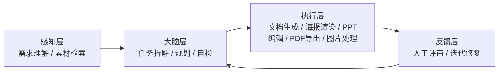

# 腾讯青训营 AI 智能体应用策划方案

## 📌 项目简介

本项目为参与腾讯青训营（Youth Camp）期间独立完成的 AI Agent 应用策划方案。旨在探索大模型智能体在具体业务场景下的落地可能性。

方案以「校园活动策划与全链路物料生成」为落地场景，以一整套真实完成的毕业季跳蚤市场活动方案（策划书、宣传海报、演示 PPT、PDF 交付件）为载体，验证智能体从需求理解到成品交付的完整能力。

## 💡 核心设计思路

*   **应用场景**：校园活动策划与物料自动化生成。以"旧物换新友·2026 毕业季绿色传承跳蚤市场"活动为真实案例，覆盖需求拆解、筹备时间表、预算表、现场分区图设计，以及四类宣传海报、方案 PPT 与 PDF 交付件的全链路生产。
*   **Agent 工作流**：采用 Plan-and-Solve（先规划后执行）为主、ReAct（推理—行动循环）为辅的智能体链路，包含：
    *   **感知层**：理解自然语言需求，检索并定位本地素材（如从下载目录定位参考 PPT、提取已有海报源文件与插画资源）。
    *   **大脑层**：大模型完成任务拆解与规划（筹备时间线、物料清单、预算结构、风险预案），并在生成后自检（页面元素越界、章节编号重复、数据口径前后不一致）。
    *   **执行层**：调用工具/技能落地执行——文档与 HTML 生成、HTML 海报无头浏览器渲染为图片、PPT 页面增删改与动画写入、PDF 导出、图片去水印等。
    *   **反馈层**：多轮人工评审（排版失衡、插画缺失、emoji 跨设备兼容性、120 与 80 的摊位口径冲突）驱动迭代修正，形成"生成—评审—修复"闭环。
*   **本地部署验证**：不仅停留在 PPT 设计，已在本地 Windows 环境部署 AI 智能体平台（Marvis 桌面端），跑通基础指令下发与工作流测试：文件检索 → 文档生成 → PPT 逐页编辑与动画写入 → PDF 导出 → 图片处理，最终产出 15 页可播放 PPT 及 PDF 交付件。

## 🚀 方案展示

*   [点击此处查看方案完整 PPT（PDF版）](./旧物换新友活动方案PPT.pdf)
*   配套物料：摊主招募 / 开市预告 / 现场指引 / 回顾四类宣传海报（已在 PPT 内以 2×2 样品页呈现）、900×1200 作品封面。

### 图 1　AI 智能体四层架构链路

*图注：实线箭头为「感知 → 大脑 → 执行」主流程，金色虚线为「反馈 → 大脑」回流优化路径，构成闭环迭代。*

## 🧠 个人收获与沉淀

*   掌握了 AI Agent 的基本架构与 Prompt 调优技巧。
*   具备将复杂业务需求转化为 AI 工作流的能力，能把一句"办个跳蚤市场"拆解为时间表、预算表与分区图。
*   理解了人机协作的边界：AI 负责搭骨架与执行，方向判断由人决策（如食品区调整为运动器材区、预算取舍）。
*   为后续开发"AI 桌面管理器"等真实应用打下基础。

---

### 附：Agent 架构示意

